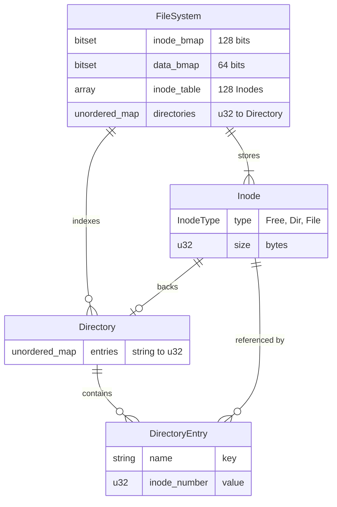

# DuFuS: Dylan's File System

File system project I'm making while learning from OSTEP. It's similar to the vsfs from the book.
To start, we will have 64 blocks, each with a size of 4KB. Inodes will be 256 bytes, so 16 inodes per block.

## Building and Testing

```bash
cmake -S . -B build \
 -DCMAKE_BUILD_TYPE=Debug \
 -DENABLE_SANITIZERS=ON

cmake --build build -j

./build/main

ctest --test-dir build --output-on-failure

./build/tests
```



## Resources

- https://pages.cs.wisc.edu/~remzi/OSTEP/file-implementation.pdf
- https://docs.kernel.org/filesystems/vfs.html
- https://github.com/torvalds/linux/tree/master
- https://en.wikipedia.org/wiki/POSIX
- https://en.wikipedia.org/wiki/File_descriptor
